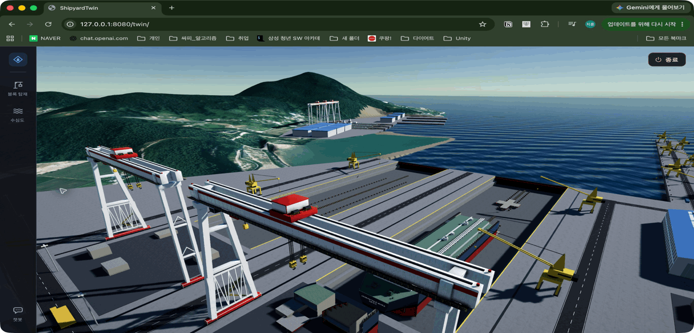
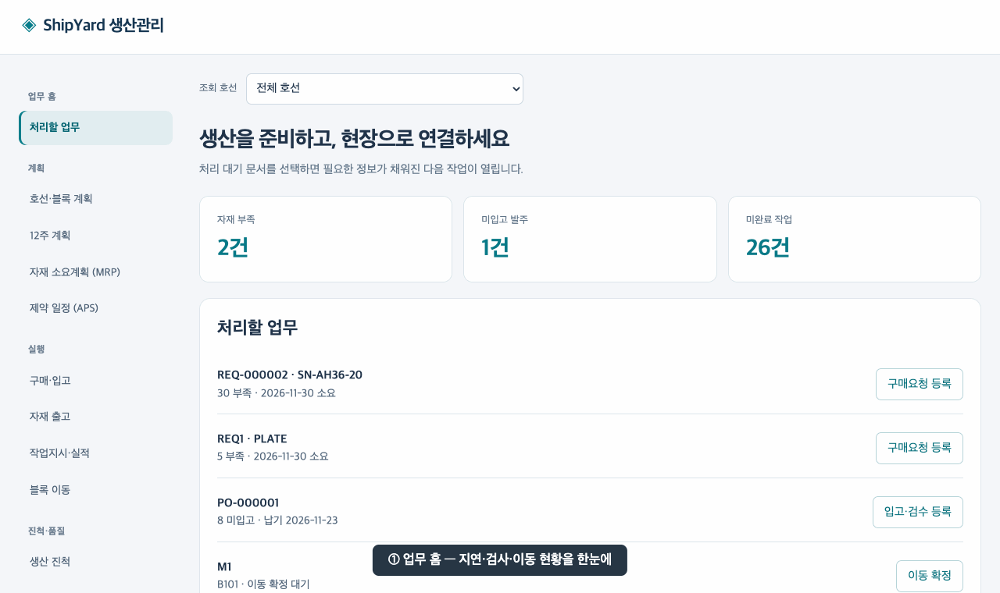

# Shipyard

조선소 생산 계획을 ERP에서 관리하고, 야드 적치와 블록 탑재를 Unity에서 재생하는 프로젝트입니다. Portal에서 ERP 화면과 API 문서로 이동할 수 있습니다.

## 데모

### Unity 디지털 트윈

가상 호선 SN2040의 여러 재생 시점을 Unity 앱에서 캡처했습니다.

ERP 데모 보기

가상 호선·블록 데이터로 만든 기존 데모입니다.

## 구현 기능

| 영역 | 기능 |
| --- | --- |
| Portal | ERP와 Swagger API 문서로 이동하는 로컬 진입 화면 |
| ERP 생산 계획 | 호선 일정, 블록 구성과 선후행, 주간·일일 작업지시, 공정 진척도, MRP·APS |
| ERP 야드 운영 | 블록 적치·이동 계획, 도크·선석 예약, 크레인 정격하중과 작업 배정, 안벽 의장 계획 |
| ERP 현장 업무 | 구매요청부터 입고·검수·출고, 강재 로트 추적, 작업 실적, 검사·품질 기록, 로그인과 메뉴 권한 |
| Unity 야드 | 생산·적치 계획과 야드 좌표를 사용해 초기 블록 상태를 표시. ERP가 연결되면 계획을 조회하고, 내장 스냅샷으로도 실행 가능 |
| Unity 블록 탑재 | 왼쪽 아이콘으로 탑재 패널을 열고 호선을 선택한 뒤 수동 재생. 크레인이 블록을 들어 올려 선체에 배치하는 과정과 진행 이력 표시 |
| Unity 화면 조작 | 오브젝트 이름 호버, 왼쪽 드래그 이동·오른쪽 드래그 회전, 수심도 토글, 오른쪽 상단 종료, 챗봇 패널 열기·닫기 |
| 실행·성능 도구 | 공통 실행 명령, Unity 테스트·캡처·성능 측정 도구, 메시 지연 로딩과 렌더링 설정 |

## 로컬 실행

[최초 설정과 Claude Code 사용법](docs/development.md)을 따라 ERP 환경을 준비한 뒤 저장소 루트에서 실행합니다.

| 서비스 | 주소 | 명령 |
| --- | --- | --- |
| Portal | `127.0.0.1:8080` | `tools/dev portal` |
| ERP 웹·API | `127.0.0.1:8001` | `tools/dev erp` |
| PostgreSQL | `127.0.0.1:55432` | `tools/dev db-up` |
| Redis | `127.0.0.1:56379` | `tools/dev db-up` |
| Unity Twin | macOS 앱 / Unity Play Mode | `tools/dev twin-build` 후 `tools/dev twin-run` |

- [ERP 상세 기능과 API](apps/erp/README.md)
- [Unity 상세 기능과 데이터 갱신](apps/twin/README.md)
- [ERP–Twin 연동 기준](shared/contracts/README.md)
- [Unity 작업별 파일 위치](apps/twin/docs/project-map.md)

실제 환경변수 파일, 로컬 DB, Unity 빌드, 위성 사진은 별도 로컬 설정으로 관리합니다.
