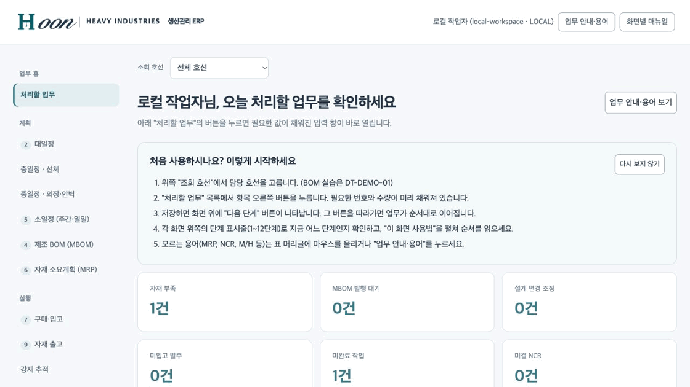

# ShipYard-ERP

**디지털 트윈 연동을 위한 조선소 생산관리 ERP (MVP)**

호선·블록 계획부터 자재 구매, 작업 실적, 블록 이동까지 조선 생산 데이터를 한곳에서 관리하고, 그 결과를 Unity 등 디지털 트윈이 바로 읽을 수 있는 JSON API로 제공합니다. (Python · PostgreSQL 17)
트윈은 ERP가 확정한 **블록 위치·이동 상태**를 기준으로, 크레인 **텔레메트리(X/Y·하중)**를 시간순으로 재생합니다.



[SIWS 화면 시연](../../docs/demo.md)

## 주요 기능

| 영역 | 내용 |
|---|---|
| 계획 | 호선 주요 일정(착공~인도), 블록 구성·탑재 선후행, 12주 계획 발행본, MRP(자재 부족), APS(휴일·다중 선행 반영) |
| 도크·크레인 | 장비 정격하중·배치, 도크 점유 예약(중복 금지), 휴일 달력, 크레인 용량·선행 블록·도크 예약을 반영한 탑재 일정 제안 |
| 크레인 계획 | 크레인별 작업 배정(일자·시작 시각·시간·인양 중량·작업 위치), 정격하중 초과·같은 크레인 시간 겹침 금지, 주별 가동률(2교대 16시간 × 5일 기준)과 최대 인양. 탑재 일정 제안은 크레인 계획에 잡힌 블록의 날짜·크레인을 그대로 씀 |
| 안벽 계획 | 선석(안벽·피어 위치·길이·수심), 호선별 선석 배정(선석 길이 초과·같은 선석 기간 겹침·한 호선 두 선석 동시 배정 금지), 진수 후 이동·선석 이동·시운전 출항/귀항·인도 출항 계획과 실제 이동일, 선석 점유 현황(길이 여유, 진수 전 배정, 흘수 점검) |
| 의장작업 계획 | 호선·구역·공종·단계(선행/탑재 후/안벽/시운전 준비)별 작업, 계획 공수·인원·진척률·상태, 작업 선후행(순환 금지), 구역별 계획 대비 실적 공수와 공정 지수(SPI), 종료일 경과·착수 지연·선행 미완료 착수 점검 |
| 실행 | 구매요청 → 발주 → 입고·검수 → 자재 출고(수불부), 주간/일일 작업지시와 실적 |
| 블록 조립·공수 | 절단·가공 → 소조립 → 중조립 → 대조립 → PE → 탑재 단계, 단계별 계획/투입 공수(M/H)와 누적 진척률, 사내협력사 |
| 강재 추적 | 입고 로트(히트번호·밀시트), 출고별 로트 배정, 반납·잔재·폐기, 블록별 강재 추적, 블록 트리 자재 소요 |
| 의장품 | 선행/후행 의장품의 입고 → 설치 → 검사 완료 진행 |
| 진척·품질 | 공정별 계획 대비 실적, 중량·공수 기반 물량 진척, 작업 검사, ITP(선주·선급 입회), NCR, 펀치리스트, 탑재 준비 판정 |
| 블록 이동·탑재 | 이동 시작·확정 트랜잭션, 크레인 정격하중 검사, 탑재 검사 실적(선행 블록 탑재를 증명) |
| 관리 | 도면 리비전·설계 변경, 로그인·회원 관리, 그룹별 메뉴 조회/등록 권한, 로그인·감사 이력 |
| 성능 | Redis 세션 토큰, 버전 기반 조회 캐시, 메뉴별 지연 로딩, 서버 측 검색·페이지 |

## API 문서 (Swagger)

서버 실행 후 **http://127.0.0.1:8001/docs** 에서 Swagger UI로 모든 API를 확인하고 실행할 수 있습니다. OpenAPI 3.0 문서는 `GET /api/openapi.json`입니다.

1. **인증 › POST /api/login**에서 `Try it out` → 아이디·비밀번호 입력 → `Execute`. 받은 토큰이 자동으로 **Authorize**에 설정됩니다(직접 붙여 넣어도 됩니다).
2. 메뉴별 태그에서 조회(GET)와 등록(POST)을 실행합니다. 등록 본문의 필수 항목, 선택값(enum), 날짜 형식, 자동 채번 여부가 표시됩니다.
3. 권한은 로그인한 사용자 그룹을 따릅니다. 권한이 없으면 403, 토큰이 없거나 만료되면 401이 반환됩니다.

문서는 서버의 조회 경로·입력 필드·메뉴 정의에서 자동 생성되므로 코드와 항상 일치합니다. Swagger UI 스크립트는 jsDelivr CDN(`swagger-ui-dist@5.17.14`)에서 불러오므로 인터넷 연결이 필요합니다.

## 디지털 트윈 연동

모든 조회 API는 로그인 토큰이 필요합니다. Unity도 사용자 계정으로 로그인해 토큰을 받습니다(트윈 전용 그룹에 `블록 이동` 조회 권한만 주는 것을 권장).

```
POST /api/login  {"id": "twin", "password": "..."}  → {"token": "...", "expires_in": 28800}
GET  /api/blocks     (헤더: Authorization: Bearer <token>)     → 블록 id, 확인 위치(location), position_status(confirmed | in_transit | unknown)
GET  /api/moves      → block, equipment, origin → destination, started_at / confirmed_at
GET  /api/telemetry  → move, recorded_at, x, y (m), load (t)
```

- 트윈은 `blocks.id → moves.block → telemetry.move` 순으로 연결하고 `recorded_at` 기준으로 재생합니다.
- 블록의 위치는 **ERP에서 이동을 확정해야** 바뀝니다. 텔레메트리만으로는 위치가 바뀌지 않습니다.
- 가상 시설 기준점: `DT-FAB(20,30)`, `DT-OUT(160,50)`, `DT-YARD(290,115)`, `DT-DOCK(430,170)`
- 가상 데이터: SN2037~SN2039 호선, 블록 72개, 이동 39건, 관측값 약 2,200건
- 블록 형상: `GET /api/hull_geometry`(형심·흘수·프레임 간격), `GET /api/block_geometry`(블록 박스 `x/y/z_min·max`, 무게중심 `cog_x/y/z`, 크기 `size_x/y/z_m`, 프레임 구간, 중량). 좌표(m)는 선미 끝 x=0(선수 방향 +), 중심선 y=0(좌현 +), 기선 z=0입니다. `geometry_source`는 `추정` 또는 `CAD`이며, 메뉴는 **관리 › 설계 도면**입니다.
- 탑재 재생: `GET /api/erection_timeline?hull=`(블록별 형상·무게중심, 탑재 단계 = 선행 체인 길이, 계획·실적일, 선행 블록, 모델 키 `model_asset`), `GET /api/location_geometry`(시설 야드 좌표·방향), `GET /api/hull_placements`(도크 안 선체 기준점·방향). 메뉴는 **도크·크레인 계획**과 **호선·블록 계획 › 탑재 순서(트윈)**입니다.
- 지도 좌표: `yard_sites`(조선소 부지 위경도·야드 x축 방위각, 1곳), `location_geometry`의 시설 크기(`size_x/y/z_m`), `GET /api/location_geo`(시설 위경도·모서리). 지도 화면은 SIWS의 `/map`에서 제공합니다.
- 조선소 운영 계획: `GET /api/crane_assignments`, `crane_load`(크레인·주별 가동률), `berths`, `berth_assignments`, `berth_occupancy`, `quay_shifts`, `shift_points`(도크·선석·해상 지점), `outfit_works`(선행 작업·실적 공수·일정 점검 포함), `outfit_links`, `outfit_progress`(호선·구역별 SPI). 등록은 같은 이름의 `POST /api/<항목>`이고, 이미 있는 `id`로 보내면 그 문서를 고칩니다(진척률·실제 이동일 입력). 화면에서는 각 행의 **수정** 버튼을 씁니다.
- 그 밖의 조회 항목(`hulls`, `locations`, `activities`, `plans`, `orders`, `mrp`, `aps` 등)도 `GET /api/<항목>`으로 조회합니다.
- 토큰은 마지막 사용 후 8시간 동안 유효하며, 만료되면 `401`이 반환되므로 다시 로그인합니다. 비밀번호 변경·초기화나 계정 중지 시 즉시 폐기됩니다.
- 서버 검색·페이지: `GET /api/telemetry?q=MV-000005&hull=SN2037&sort=recorded_at&dir=desc&page=0&size=200` → `{"rows", "total", "page", "size", "pages"}`. 지원 조건은 `q, hull, material, location, date_key, from, until, sort, dir, page, size`입니다. 조건 없이 호출하면 기존처럼 전체 배열을 반환합니다.

## 실행 방법

Python 3.9 이상과 Docker가 필요합니다. 데이터베이스는 **PostgreSQL 17**(`127.0.0.1:55432`), 세션·캐시는 **Redis**(`127.0.0.1:56379`)를 사용합니다(Docker Compose).

```sh
cp .env.example .env                      # SHIPYARD_DB_PASSWORD, SHIPYARD_REDIS_PASSWORD 값 변경
docker compose up -d                      # PostgreSQL 17 + Redis 실행
python3 -m venv .venv && .venv/bin/pip install -r requirements.txt
./shipyard-postgres create_admin.py --id admin --name 관리자   # 첫 관리자 (비밀번호 입력)
./shipyard-postgres app.py                # 서버 실행 → http://127.0.0.1:8001
./shipyard-postgres seed_sn2036.py        # SN2036 실습 데이터
./shipyard-postgres seed_twin.py          # 디지털 트윈용 SN2037~2039 데이터
./shipyard-postgres seed_production.py    # SN2036에 조립 단계·공수·로트·ITP/NCR 예시 추가
```

새 버전으로 서버를 다시 시작하면 추가 테이블이 자동으로 생성됩니다(기존 데이터는 그대로 유지).

`shipyard-postgres`는 `.env`의 비밀번호로 `SHIPYARD_DATABASE_URL`과 `SHIPYARD_REDIS_URL`을 구성한 뒤 Python을 실행하는 스크립트입니다. PostgreSQL 모드에서는 Redis가 필수입니다. 기존 SQLite 예시 DB를 옮길 때는 `migrate_sqlite.py`를 사용합니다.

> Docker 없이 화면만 확인하려면 SQLite 파일로도 실행할 수 있습니다(세션·캐시는 프로세스 메모리 사용): `python3 -B create_admin.py --db local.sqlite3 --id admin --name 관리자` 후 `python3 -B app.py --db local.sqlite3`

**테스트**

```sh
python3 -B -m unittest -v
```

## 구성

```
app.py            HTTP 서버, 스키마, API
index.html        업무 화면 (단일 페이지)
shipbuilding.py   호선 일정, 블록 구성·선후행, 탑재 준비 판정
production.py     블록 조립 단계, 공수·진척, 의장품, 도면 리비전, 탑재 검사 실적
resources.py      장비 능력, 도크 예약, 휴일 달력, 탑재 일정 제안
yardplan.py       크레인 작업 배정·부하, 선석·선석 배정·안벽 이동, 의장 작업·선후행·진척
lots.py           강재 로트·히트번호, 로트 배정, 반납·잔재, 블록 트리 소요
quality.py        ITP, 입회 검사, NCR, 펀치리스트
auth.py           로그인, 그룹·메뉴 권한, Redis 세션, 로그인 잠금, 감사 이력
cache.py          Redis 저장소(로컬은 메모리 대체), 버전 기반 조회 캐시
menus.py          메뉴·조회 경로·저장 작업 매핑 (서버 권한 검사와 화면 메뉴가 공유)
search.py         서버 측 검색·호선 범위·정렬·페이지
openapi.py        OpenAPI 3 문서 생성, Swagger UI(/docs)
create_admin.py   관리자 계정 생성·재설정
planning.py       MRP · APS
procurement.py    구매·입고·출고
traceability.py   문서 번호와 원천 문서 추적
storage.py        PostgreSQL 어댑터 (로컬 SQLite 겸용)
compose.yaml      PostgreSQL 17 컨테이너
seed_*.py         가상 데이터
```

자세한 사용법은 [USER_GUIDE.md](USER_GUIDE.md), 작업 내역은 [REPORT.md](REPORT.md)를 참고하세요.

## 범위와 한계

로컬 환경에서만 실행하는 MVP입니다. HTTPS가 없으므로 외부 네트워크에 공개하려면 TLS 종단(리버스 프록시)이 필요합니다. 비밀번호 찾기(메일 발송)와 다중 인증은 없습니다. 블록의 세부 좌표·회전·3D 형상, 실제 센서 연결, 네스팅(절단 배치) 최적화, 대금 정산은 포함하지 않습니다.
