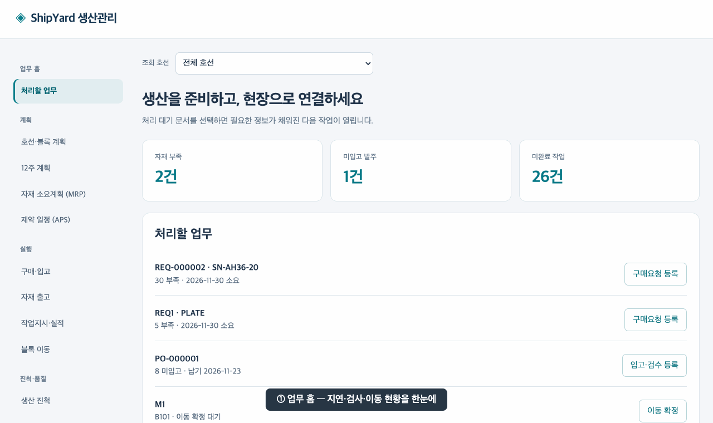
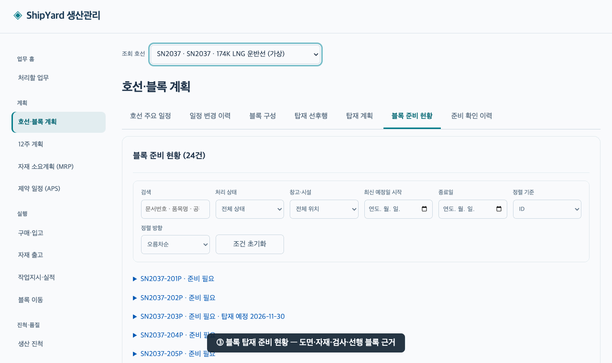
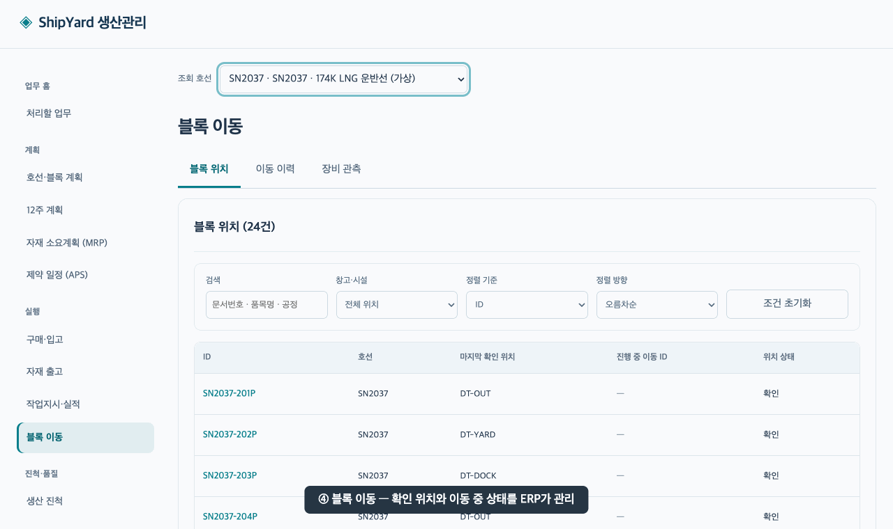
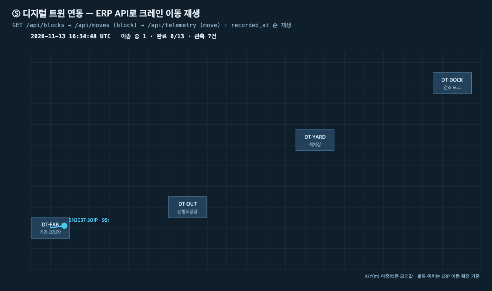

# SIWS 화면별 시연

[프로젝트 개요](../README.md) · [현재 기능 명세](spec.md)

## SIWS 포털

기존 포털 프리뷰의 로그인 화면과 운영 현황 화면을 순서대로 보여주는 GIF입니다. 운영 현황의 수치는 가상 데이터입니다.

| 화면 | 기능 |
| --- | --- |
| 로그인 | ERP 계정으로 로그인하는 화면 |
| 조선소 모니터링 | 등록 호선·등록 블록·이동 중·재검사 필요 건 요약과 운영 현황 진입 |
| 업무 시스템 | 생산관리 ERP 접속과 Mac의 Unity 앱 실행 진입 카드 |

브라우저에서 확인한 브랜드 포털의 로그인 경로는 [로컬 8010 포털](http://127.0.0.1:8010/)입니다. 저장소의 `tools/dev portal`은 [로컬 8080 포털](http://127.0.0.1:8080/)을 열며 ERP·Swagger 링크와 Unity 실행 안내를 제공합니다.

## ERP 업무 홈과 호선 선택

전체 호선의 자재 부족, 발주 대기, 미완료 작업을 본 뒤 SN2037을 선택하면 해당 호선의 업무로 좁혀집니다.

## ERP 블록 탑재 준비

블록별 예정일과 도면·자재·검사·선행 작업의 준비 상태를 확인합니다. 현재 메뉴는 **계획 → 중일정 · 선체 → 블록 준비 현황**입니다.

## ERP 블록 위치

**실행 → 블록 이동**에서 마지막 확인 위치와 진행 중 이동을 확인합니다. 이동을 확정하면 목적지가 ERP의 확인 위치에 반영됩니다.

## ERP 관측값으로 크레인 이동 재생

예시 관측값을 시간순으로 재생합니다. 블록이 가공장·선행의장장·적치장·도크 사이를 이동할 때 좌표와 하중이 어떻게 바뀌는지 볼 수 있습니다.

ERP GIF는 기존 시연을 화면별로 나눈 것입니다. 준비 현황과 블록 위치는 정지 프레임입니다. 현재 메뉴 이름과 구현 범위는 [기능 명세](spec.md)에 정리했습니다.

## Unity 블록 탑재

가상 호선 SN2040의 여러 재생 시점을 캡처했습니다. 처음에 비어 있던 도크에 블록이 순차적으로 쌓이고, 탑재 패널의 블록 수·중량 진척과 작업 이력이 바뀝니다.

1. Unity 앱을 열고 왼쪽 **블록 탑재**를 눌러 SN2040을 선택합니다.
2. **처음부터**와 **재생**을 차례로 눌러 인양·안착과 진척 변화를 봅니다.
3. **4**로 크레인 시점, **F**로 인양 블록 추적, **6**으로 야드 전체 시점으로 바꿉니다.
4. **수심도**를 켜고 등심선과 범례를 확인합니다. 시설이나 블록 위에 마우스를 올리면 대상 정보가 뜹니다.

[Unity 실행·캡처 명령과 데이터 출처](../apps/twin/README.md)
