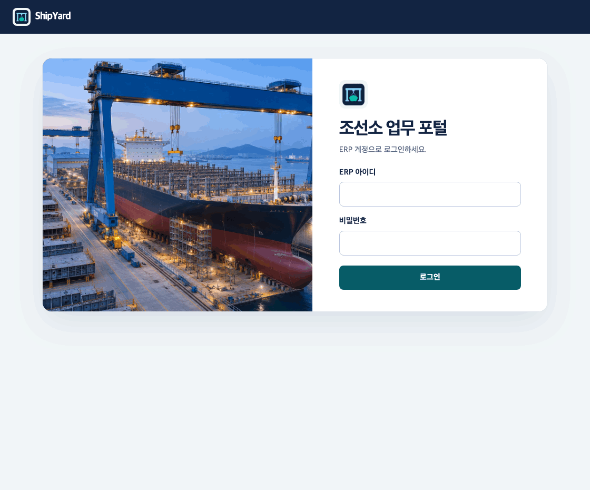
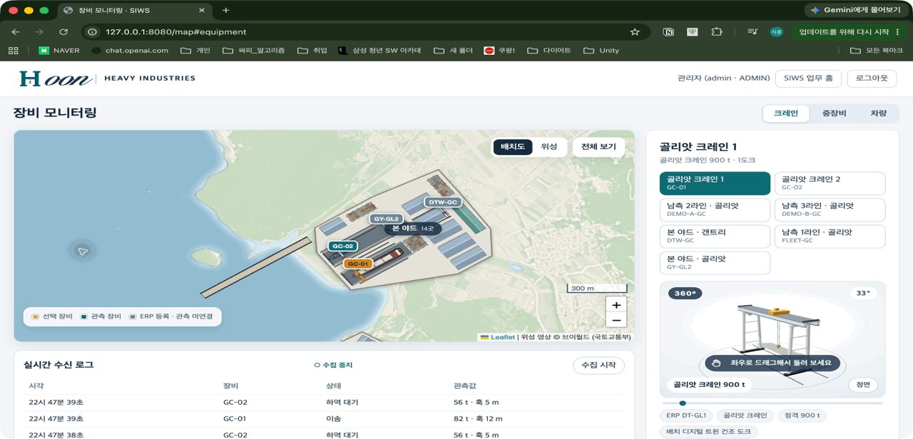
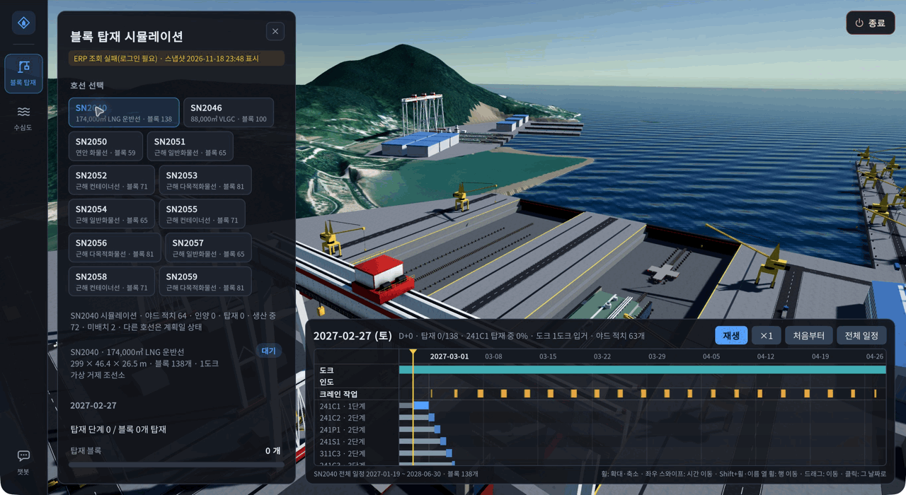
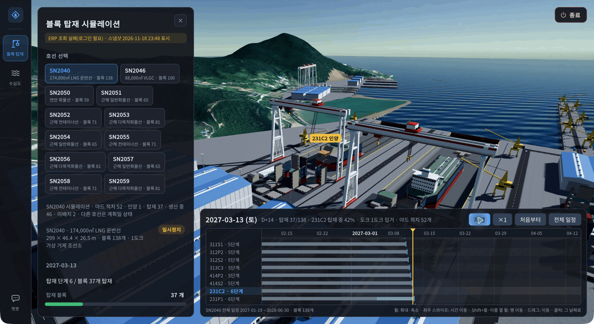

# SIWS 화면별 시연

[프로젝트 개요](../README.md) · [현재 기능 명세](spec.md)

## SIWS 포털

[통합 포털](http://127.0.0.1:8080/)에서 ERP 계정으로 로그인하면 조선소 운영 지표와 이동 현황을 볼 수 있습니다. 생산관리 ERP·Swagger·조선소 지도·장비 모니터링으로 이동하고, WebGL 빌드가 준비되어 있으면 포털에서 Unity 디지털 트윈을 열 수 있습니다.

## 장비 모니터링과 가상 데이터 수집

포털에서 **장비 모니터링**을 열고 **크레인 → 중장비 → 차량** 순으로 전환합니다. 장비를 선택하면 지도 위치, 장비 유형별 관측값, 수집 이력과 3D 모델을 확인할 수 있습니다. 관리자 계정으로 수집을 시작하면 시뮬레이터가 가상 운전 데이터를 생성하고 InfluxDB에 기록합니다.

## ERP 계획과 자재 소요

업무 홈에서 처리 대기를 확인합니다. 대일정에서는 호선 주요 일정과 도크·선석 배정을, 제조 BOM에서는 리비전과 발행 단계를 조회합니다. MRP에서 자재 소요와 부족 내역을 조회합니다.

## ERP 작업지시·품질·블록 이동

작업지시와 작업 검사 목록을 확인하고 블록 위치 화면에서 마지막 확인 위치와 이동 상태를 조회합니다.

## Unity 야드와 시점 전환

[포털의 Unity WebGL 화면](http://127.0.0.1:8080/twin/)에서 기본 시점, 야드 전체 시점, 크레인 시점을 차례로 촬영했습니다.

## 호선별 블록 탑재 시뮬레이션

### SN2040 재생과 크레인 추적

1. 포털의 **디지털 트윈**을 열고 왼쪽 **블록 탑재**에서 **SN2040**을 선택합니다. 시연에 사용한 스냅샷에는 총 138개 블록이 표시됩니다.
2. 하단의 **재생**을 누르면 날짜 표시선이 이동하고, 타임라인에서 현재 블록의 작업 구간을 확인할 수 있습니다. 3D 야드에는 인양 중인 블록 ID가 표시됩니다. **4**로 크레인 시점, **F**로 인양 블록 추적 시점에 들어갈 수 있습니다.
3. **일시정지**를 누르면 그 시점의 블록 상태와 진척을 살펴볼 수 있습니다. GIF 마지막에는 37개가 탑재되고 231C2 블록은 인양 중입니다. 배속 버튼으로 재생 속도를 바꾸고 **처음부터**로 시작 시점에 돌아갑니다.

### 전체 일정과 호선 전환

- **전체 일정**을 누르면 타임라인을 호선 전체 일정으로 펼칩니다. **탑재 구간**을 누르면 블록 배치와 크레인 작업을 확인하던 구간으로 돌아옵니다.
- 호선 목록에서 **SN2052**를 선택하면 배치된 도크 쪽으로 카메라가 이동하고, 날짜·블록 수·타임라인이 해당 호선의 계획으로 전환됩니다.
- 이 시연은 WebGL 빌드에 포함된 스냅샷으로 촬영했습니다. 상단에 ERP 조회 상태와 스냅샷 시각이 표시됩니다.

[Unity 실행·캡처 명령과 데이터 출처](../apps/twin/README.md)
