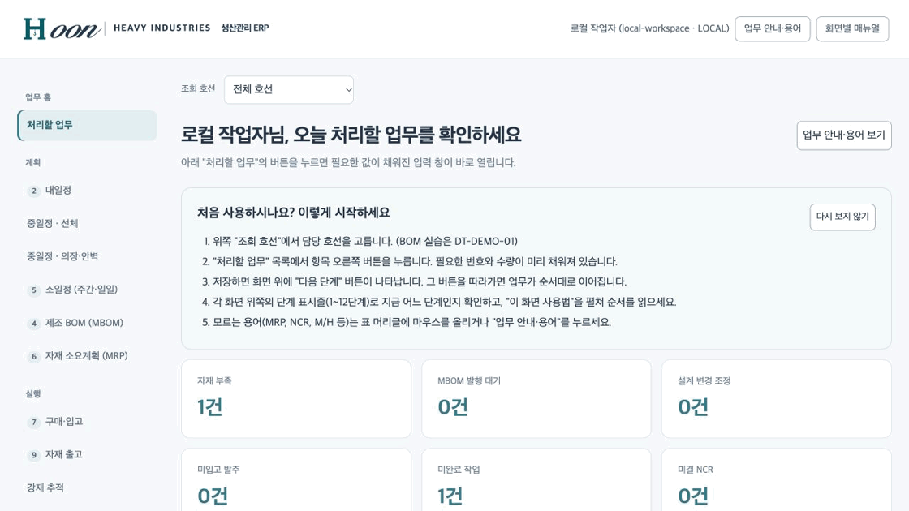
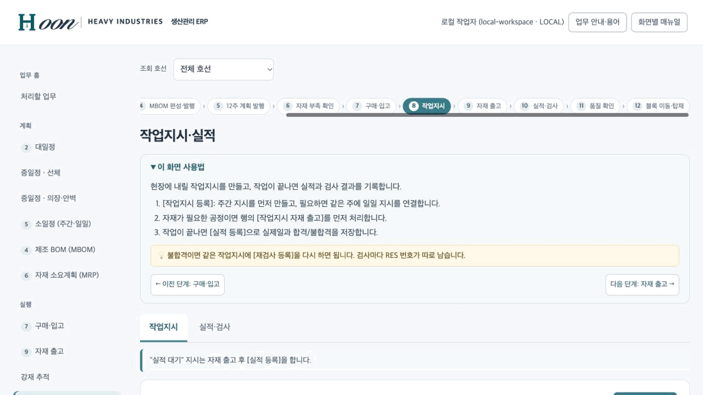
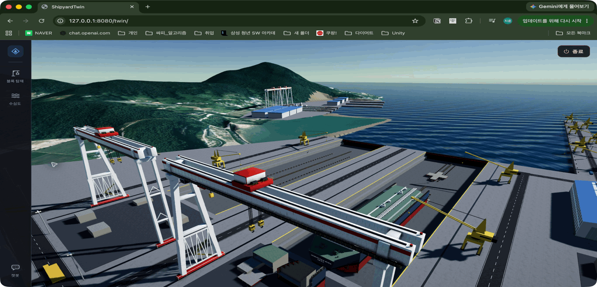

# SIWS 화면별 시연

[프로젝트 개요](../README.md) · [현재 기능 명세](spec.md)

## SIWS 포털

[통합 포털](http://127.0.0.1:8080/)에서 ERP 계정으로 로그인하면 조선소 운영 지표와 이동 현황을 볼 수 있습니다. 생산관리 ERP·Swagger·조선소 지도에 접근할 수 있으며, 로컬에 Unity 빌드가 있으면 포털에서 앱을 실행할 수 있습니다.

## ERP 계획과 자재 소요

업무 홈에서 처리 대기를 확인합니다. 대일정에서는 호선 주요 일정과 도크·선석 배정을, 제조 BOM에서는 리비전과 발행 단계를 조회합니다. MRP에는 가상 호선 H101의 자재 부족 1건이 표시됩니다.

## ERP 작업지시·품질·블록 이동

작업지시와 작업 검사 목록을 확인하고 블록 위치 화면에서 마지막 확인 위치와 이동 상태를 조회합니다. 두 ERP GIF는 [통합 ERP](http://127.0.0.1:8001/)를 데모 SQLite 데이터로 실행해 촬영했습니다.

## Unity 야드와 시점 전환

현재 실행 중인 Unity 앱에서 기본 시점, 야드 전체 시점, 크레인 시점을 차례로 촬영했습니다. 블록 탑재는 앱에서 아래 순서로 조작할 수 있습니다.

1. Unity 앱을 열고 왼쪽 **블록 탑재**를 눌러 SN2040을 선택합니다.
2. **처음부터**와 **재생**을 차례로 눌러 인양·안착과 진척 변화를 봅니다.
3. **4**로 크레인 시점, **F**로 인양 블록 추적, **6**으로 야드 전체 시점으로 바꿉니다.
4. **수심도**를 켜고 등심선과 범례를 확인합니다. 시설이나 블록 위에 마우스를 올리면 대상 정보가 뜹니다.

[Unity 실행·캡처 명령과 데이터 출처](../apps/twin/README.md)
